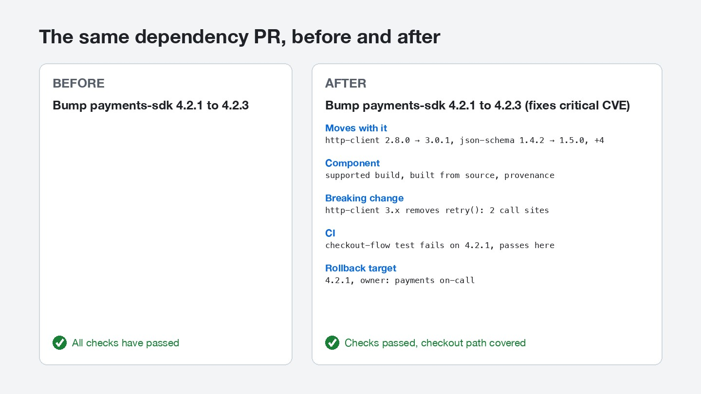

And… the pull request is open again, with the same title as yesterday, bumping one package to the version that fixes a critical CVE, and the same green check underneath it, so the only real difference is that everyone on the review now knows what happened the last time somebody approved it.

In the last post, [You shipped the fix. Now the FAA has a ground stop](https://erict.net/2026/11/19/faa-ground-stop.html), we rolled back a CVE fix to get checkout moving and asked what the team would need to see before shipping it again. This post is that list, written as what the retry should show before anyone approves it.

Credit where it's due: Dependabot [merged its first pull request in April 2017](https://github.blog/news-insights/company-news/one-million-dependabot-pull-requests-merged/) and turned dependency updates from a chore someone remembered once a quarter into something that shows up in the queue on its own, and most of us have been depending (har) on it ever since. Opening the PR is a solved problem. The work that's left lives between the moment the bot opens it and the moment a person decides to approve it.



## What the reviewer needs to know

A version bump tells the reviewer which package the bot meant to move, and on the first attempt, for many companies without super verbose/smart CI, that was all anyone on the review knew, which is how a change that touched seven packages got approved as if it touched one. I mean, they are only transitive deps, right? Before approving the retry, put the rest of the story in the PR itself, not in a ticket or a Slack thread or someone's memory of the incident, because the reviewer is the person who has to decide and the PR is the one thing they're sure to read.

We've covered the dependencies nobody checks before. In [an earlier piece on making the governed path the fastest path](https://www.activestate.com/blog/governed-path-fastest-path-ai-assisted-engineering/), an AI assistant's suggested import pulls a package nobody evaluated into the build, along with every transitive dependency it brings, and in [a look at the three-year cost of a dependency](https://www.activestate.com/blog/open-source-dependency-three-year-cost-engineer-weeks), even a package that does get reviewed brings its own dependencies that rarely get evaluated separately. We made the same point about AI-picked packages in [Nobody is governing the dependencies your AI assistant picks](https://www.activestate.com/blog/nobody-is-governing-the-dependencies-your-ai-assistant-picks-thats-the-actual-risk), and OWASP [ranks software supply chain failures third in its 2025 Top 10](https://top10.owasp.org/2025/A03_2025-Software_Supply_Chain_Failures/), which makes the dependency PR the last cheap place to look at what's actually moving.

Start with which versions moved together. In the checkout incident, the lockfile changed six packages alongside the one the team meant to update, and a reviewer can't reason about a change they can't see, so list every one of them with its old and new version. Then say what the update actually fixes: which CVE, which of your services ship the affected version today, and where the fixed component came from, since a fix nobody can trace is one more thing you're asking the reviewer to take on faith.

Once the reviewer knows what's moving and why, show what might break, meaning any API the new versions remove or change and the calls in your own code that depend on them. That count decides the plan, because one call site is an afternoon for whoever owns checkout, while thirty is a sprint item that [belongs on the roadmap](https://www.activestate.com/blog/open-source-dependency-three-year-cost-engineer-weeks) before anyone approves anything. Last, show what CI actually exercised, which is a different question from whether the checks passed: which tests ran against the changed code, and whether the checkout path the first attempt missed is now one of them. If it isn't, the green check on the retry means what it meant the first time.

## The same example PR, before and after

Before:

```
Bump payments-sdk from 4.2.1 to 4.2.3
✓ All checks have passed
```

After:

```
Bump payments-sdk from 4.2.1 to 4.2.3 (fixes critical CVE)
Moves with it: http-client 2.8.0 → 3.0.1, json-schema 1.4.2 → 1.5.0, plus 4 more (full list below)
Component: supported build, built from source, provenance attached
Breaking change: http-client 3.x removes retry(), used in 2 call sites in checkout/
CI: new checkout-flow test fails on 4.2.1 + old http-client, passes here
Rollback target: 4.2.1, owner: payments on-call
```

The package names are illustrative, and the second version takes a few more minutes to put together, but those minutes give the reviewer something to check instead of something to trust, which is the difference between an approval that means the change was understood and one that means CI happened to be green.

## Where ActiveState fits

At ActiveState, we provide some of the "after" today. For the components we support, we supply a remediated build along with [evidence of where it came from](https://slsa.dev/), including built-from-source status and [an SBOM](https://www.cisa.gov/sbom) or attestation where available, and sometimes that build lets a team take the fix without dragging everything else in the lockfile along with it.

We’re also building the rest. The secure easy button. Putting the dependency diff into the PR and showing which of your calls a breaking change touches are on our roadmap rather than in the product, so until they ship, your team still writes that part of the description, and the application owner still makes the code change when an API goes away.

## The comment to leave

If the retry shows up with only the "before" version, leave this review comment:

> Which other packages does this move, and which test proves checkout works with all of them?

What's the comment you'd leave?
