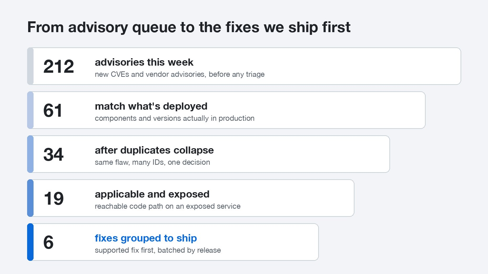

It's Monday, the release goes out Thursday, and the security queue has grown faster than anyone can read it: about two hundred new advisories since the last release, a handful marked critical, a couple already showing up in customer questionnaires, and the same four engineers who know the affected services are busy shipping features and bug fixes.

In the last post, [How to review a dependency PR before it causes an outage](https://erict.net/2026/11/23/dependency-pr-review.html), we looked at what a dependency PR should show before anyone approves it. This post backs up a step to deciding which PRs to open in the first place, because once the queue grows faster than the team can review it, every approval is also a decision about what waits, and every wait costs PR churn, CI delays, re-runs and re-reviews.

## Why the queue keeps growing

NIST reported that [CVE submissions grew 263% between 2020 and 2025](https://www.nist.gov/news-events/news/2026/04/nist-updates-nvd-operations-address-record-cve-growth), and that even after enriching roughly 42,000 CVEs in 2025, 45% more than in any previous year, the National Vulnerability Database couldn't keep up, so it now enriches CVEs in CISA's Known Exploited Vulnerabilities catalog first and marks most of the rest as not scheduled. AI is part of the reason, since finding a flaw in a widely used library costs less than it did a year ago for defenders and attackers alike. When Google Project Zero [rewrote its disclosure policy this month](https://projectzero.google/2026/11/disclosure-policy.html), it dropped the 30 days it used to give users to apply a patch and began phasing its deadline down from 90 days to 30 by 2028, citing AI-assisted discovery and how quickly attackers can work backward from a patch to the bug it fixes. That window, between a fix becoming public and your deployment of it, is the patch gap, and because publishing the fix also tells an attacker where to look, it's the part of the problem every team needs to control.

## Start from what you actually ship

Start triage from your inventory rather than the feed, because an advisory against a package you don't deploy belongs to someone else, and the only reliable way to know which advisories are yours is a current list of the components and versions running in production, ideally [an SBOM](https://www.cisa.gov/sbom) generated by the build rather than assembled by hand. For many teams this is more difficult than it sounds. Map each advisory to that list by exact version range, then collapse the duplicates, since one flaw often arrives as a CVE, a GitHub advisory, a distro advisory and a vendor bulletin, and four tickets for one flaw means four people making the same decision four different ways.

What's left still isn't the list of things to ship. For each remaining issue, check whether it applies to how you use the component (whether your code reaches the vulnerable function, whether the affected feature is turned on, whether the service accepts the input that triggers it) and how likely it is to be used against you. [CISA's KEV catalog](https://www.cisa.gov/known-exploited-vulnerabilities-catalog) tells you what attackers are already exploiting, and [FIRST's EPSS](https://www.first.org/epss/) estimates the chance a CVE gets exploited in the next 30 days. Neither replaces your own read of exposure, but together they give the team an order it can defend, which a CVSS score never quite does.

Then group the fixes that can ship together. Prefer a supported upstream fix where one exists, since that's the version everyone else will be running and testing too, and batch the changes by service and release so the reviewer sees one coherent PR per service instead of a stack of single-package bumps that each drag the lockfile somewhere different, which is how the [checkout outage in the first post](https://erict.net/2026/11/19/faa-ground-stop.html) in this series started.

## When there's no compatible fix

Some issues won't have a fix you can take this week, often because the fixed version needs a newer runtime, removes an API you call, or doesn't exist yet. When that happens, choose among four options and write down which one you chose: upgrade anyway and plan the code change, replace the dependency, reduce exposure with configuration, a feature flag or a network control until a fix lands, or accept the risk for a defined period with a named owner and a date when someone looks again. We made that choice in the first post, when a CVE upgrade broke checkout and we had to back it out. A backport, patching the old version yourself, belongs on that list only as a deliberate exception, chosen when the support and validation you'd need to keep it safe justify the cost, because every backport is a fork someone has to maintain until the upgrade finally happens. Backports and custom patches have a very real problem: they can introduce strange bugs into an unfamiliar code base you don’t usually look at, outside your core competency, and, even worse, they can expose you to further exploits without the open source community reviewing the fix, at least until you donate the patch back upstream. You did that, right? You didn’t bogart your fix at the expense of everyone else after reaping the rewards of OSS, right?

## Let AI do the legwork, and keep the decisions reproducible

The same models that make vulnerabilities cheaper to find can do much of the triage work above: reading advisories, pulling out the affected version ranges, searching your code for call sites, and drafting the PR description from the last post. Let them, and keep the decisions that have to be repeatable, grounded in inputs and rules you can reproduce, so the inventory comes from the build, version matching follows the advisory's published ranges, the policy for what ships when is written down, and verification is a test run rather than a model's opinion that the change looks fine. We made a similar argument about [making the governed path the fastest path](https://www.activestate.com/blog/governed-path-fastest-path-ai-assisted-engineering/) for AI-assisted engineering, and it holds here too.

Decide in advance what happens when the evidence is incomplete, because it often is: an advisory without a version range, a component without an SBOM, a reachability check that can't see through reflection or a plugin system. Treat the issue as applicable until something shows otherwise, label it as unverified instead of guessing, and route it to a person with a deadline, so missing data slows one decision down without quietly dropping it from the queue.

## Who else is working on this

A lot of well-funded work landed this year on the discovery side. Anthropic's [Project Glasswing](https://www.anthropic.com/glasswing) gave major vendors and open source organizations an unreleased model to find and fix flaws in foundational software, and OpenAI's [Daybreak](https://openai.com/daybreak/) gives vetted defenders models and Codex Security tooling to find, validate and fix vulnerabilities in a similar manner. Red Hat and IBM's [Lightwell](https://www.redhat.com/en/about/press-releases/project-lightwell-secure-open-source) and Chainguard's [Athena](https://www.chainguard.dev/athena) coalition sit closer to remediation, coordinating fixes and patched artifacts for open source dependencies on behalf of their subscribers and members, often before public disclosure, while Project Zero's new policy sets the clock we may want to work against. Each of them makes it more likely that a fix exists sooner, for the chosen few. None of them can tell you which of your services runs the affected version, whether your code reaches the flaw, or whether the fixed build passes your tests.

## Where ActiveState fits

It all sounds like a lot of work in both policy and code, yeah? That’s because it is. That last stretch, from an issue that applies to you to a tested change running in production, is where we focus at ActiveState. Nobody controls when security information gets released, so we watch for the issues that touch the components we support, lay out your options, and supply a remediated build with [evidence of where it came from](https://slsa.dev/), which means the PR your team reviews starts from a component that's already fixed and traceable. As one of our engineers put it in a standup last week, the deployment is still yours, and our job at ActiveState is to give you as much information as we can and make the upgrade as easy as possible.

We're building more of that path, including the dependency diff and call-site check from the last post. Until you get in touch, the triage above is all your team's work. Once you do, our components make the last step shorter.

## The question for Monday's queue

Before the release goes out, put one question to whoever owns the queue:

> Which of these issues touch something we actually run, and what's the smallest set of changes that closes the ones that are exposed?

What's the first filter your team applies?
